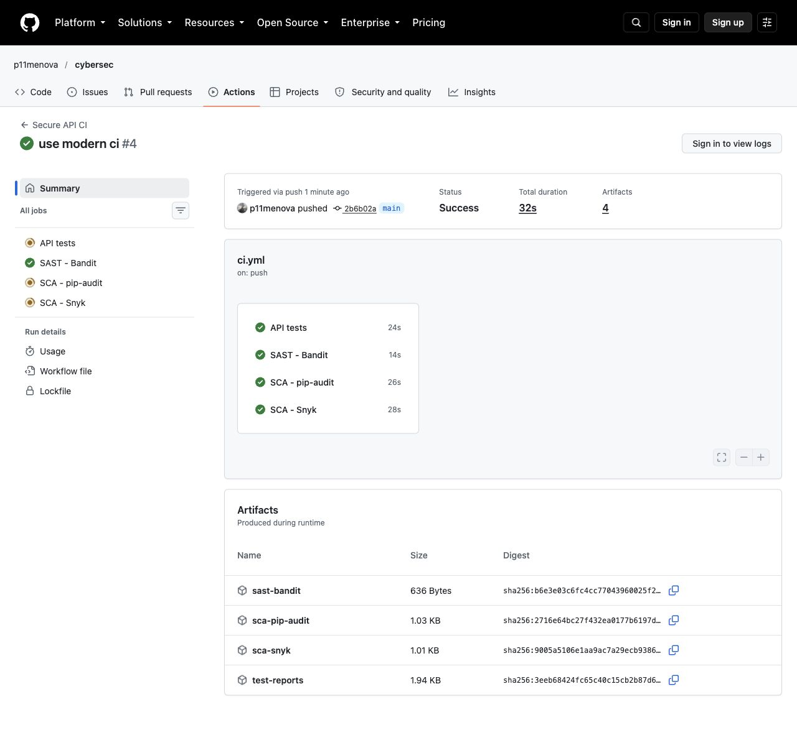

# Лабораторная работа № 1: защищённый REST API

Учебное приложение для личных заметок на **Python 3.14, Flask и SQLite**.
Пользователь входит по логину и паролю, получает JWT и читает/создаёт только свои заметки.
Проверки тестов, исходного кода и зависимостей запускаются через GitHub Actions.

- Репозиторий: [p11menova/cybersec](https://github.com/p11menova/cybersec).
- Запуски CI: [Secure API CI](https://github.com/p11menova/cybersec/actions/workflows/ci.yml).
- Конфигурация: [.github/workflows/ci.yml](.github/workflows/ci.yml).

## 1. Установка и запуск

Нужны Python 3.14 и `curl`. Команды выполняются в корне проекта.
На macOS с Homebrew можно использовать `/opt/homebrew/bin/python3` вместо системного `python3`.

```bash
python3 -m venv .venv
source .venv/bin/activate
python -m pip install -r requirements-dev.txt
```

Сгенерировать секрет один раз и сохранить локально:

```bash
python - <<'PY'
import os
import secrets
from pathlib import Path

path = Path('.env')
with path.open('x') as stream:
    stream.write('JWT_SECRET_KEY=' + secrets.token_hex(32) + '\n')
os.chmod(path, 0o600)
PY
set -a
source .env
set +a
```

Если `.env` уже существует, повторять генерацию не нужно: достаточно загрузить его через `source`.
Приложение читает переменные окружения; само файл `.env` не загружает.
В новом терминале снова активируйте `.venv` и загрузите `.env`.

Создать таблицы и учётную запись:

```bash
flask --app secure_api init-db
flask --app secure_api create-user --username student
```

Пароль вводится скрыто дважды, длина — от 12 до 128 символов. Общего пароля по умолчанию нет.
Повторный `init-db` сохраняет существующие данные. Регистрация через публичный API не предусмотрена.

Запустить сервер:

```bash
gunicorn --workers 1 --bind 127.0.0.1:8000 wsgi:app
```

SQLite хранится в `instance/notes.db`; каталог, база и `.env` исключены из Git.
Для отдельной базы можно задать абсолютный путь в переменной `DATABASE_PATH`; родительский каталог должен существовать.
Для одного лишь запуска достаточно `pip install -r requirements.txt`.

## 2. Эндпоинты и примеры curl

Все ответы, включая ошибки, имеют формат JSON. Тела POST должны иметь `Content-Type: application/json`.
В примере ниже замените `YOUR_PASSWORD` паролем созданного пользователя. Это обозначение, а не готовый пароль.

### POST /auth/login — вход

```bash
curl -i http://127.0.0.1:8000/auth/login \
  -H 'Content-Type: application/json' \
  --data '{"username":"student","password":"YOUR_PASSWORD"}'
```

Успех — `200 OK`:

```json
{"access_token":"<JWT>","token_type":"Bearer","expires_in":900}
```

Неверный логин и неверный пароль дают одинаковую ошибку `401`.
JWT действует 15 минут. После истечения срока нужно войти заново.

### GET /api/data — свои заметки

```bash
curl -i 'http://127.0.0.1:8000/api/data?limit=20&offset=0' \
  -H 'Authorization: Bearer YOUR_JWT'
```

Замените `YOUR_JWT` значением `access_token`, полученным при входе.
Успех — `200 OK`; сразу после создания пользователя список пуст:

```json
{"data":[],"limit":20,"offset":0}
```

`limit`: 1–100, по умолчанию 20. `offset`: 0–1000000, по умолчанию 0.
Заметки идут от новых к старым.

### POST /api/data — создать свою заметку

```bash
curl -i http://127.0.0.1:8000/api/data \
  -H 'Authorization: Bearer YOUR_JWT' \
  -H 'Content-Type: application/json' \
  --data '{"title":"Первая заметка","body":"SQLite и JWT работают"}'
```

Успех — `201 Created`:

```json
{"data":{"id":1,"title":"Первая заметка","body":"SQLite и JWT работают","created_at":"2026-10-18 18:00:00"}}
```

Дата приведена как пример; реальное время создания формирует SQLite в UTC.
`title` — непустая строка до 120 символов; `body` — непустая строка до 5000 символов.
Передать чужой `user_id` нельзя: владелец всегда определяется сервером по JWT.

### Доступ без токена запрещён

```bash
curl -i http://127.0.0.1:8000/api/data
```

Результат: `401 Unauthorized`, заголовок `WWW-Authenticate: Bearer`, JSON с ошибкой.
Ограничения также действуют на `POST /api/data`.

Прочие коды: `400` — неверные поля/JSON/пагинация, `404` — неизвестный путь,
`405` — неподдерживаемый метод, `413` — тело больше 16 КиБ,
`415` — неверный Content-Type, `429` — превышен лимит запросов.

## 3. Реализованные меры защиты

### SQL Injection — параметризованные запросы

Используется стандартный модуль `sqlite3`. Все значения пользователя передаются отдельными параметрами `?`:

```python
user = get_db().execute(
    "SELECT id, password_hash FROM users WHERE username = ?", (username,)
).fetchone()
```

Вставка заметок и фильтрация по владельцу устроены так же. SQL не собирается из пользовательских строк.
Схема базы состоит из фиксированного SQL без внешнего ввода.
Тесты проверяют, что логин `' OR 1=1 --` не обходит вход,
а текст `'); DROP TABLE users; --` сохраняется как данные и не удаляет таблицу.

### XSS — экранирование при выдаче данных

Поля `title` и `body` перед сериализацией проходят через `markupsafe.escape()`:
`<`, `>`, `&`, одинарные и двойные кавычки заменяются HTML-сущностями.
В базе остаётся оригинальный текст: экранирование выполняется на выходе и не накапливается при повторных GET.
Например, `<script>` возвращается как `&lt;script&gt;`.

Ответ имеет `Content-Type: application/json` и `X-Content-Type-Options: nosniff`.
Дополнительно выставляются CSP `default-src 'none'; frame-ancestors 'none'`,
`X-Frame-Options: DENY` и `Referrer-Policy: no-referrer`.
Клиенту следует выводить данные через `textContent`; декодировать сущности и вставлять результат через `innerHTML` нельзя.
Это учебный API без HTML-страниц: экранирование включено явно по требованиям работы.

### Аутентификация — Argon2id и JWT

- Пароли хэшируются `argon2-cffi` с Argon2id и уникальной случайной солью. В SQLite хранится только `password_hash`.
- Параметры по умолчанию `PasswordHasher`: 64 МиБ памяти, 3 прохода, параллелизм 4; параметры и соль записаны в хэше.
- При успешном входе устаревший по параметрам хэш пересчитывается через `check_needs_rehash()`.
- Несуществующий пользователь проверяется с фиктивным Argon2-хэшем; ответ совпадает с ошибкой пароля.
- JWT подписывается HS256. Секрет берётся из окружения, минимум 32 байта; инструкция генерирует 32 случайных байта как hex.
- Декоратор `require_token` проверяет подпись, фиксированный алгоритм HS256, срок `exp`, время `iat`/`nbf`, issuer и audience.
  Обязательны `exp`, `iat`, `nbf`, `sub`, `iss`, `aud`, `jti`; `sub` должен соответствовать существующему пользователю.
- `sub` содержит только идентификатор пользователя. Пароли и заметки в JWT не включаются.
- Оба метода `/api/data` требуют Bearer-токен; SELECT фильтрует по владельцу, INSERT берёт владельца из проверенного JWT.
- Лимит входа: 5 запросов в минуту и 20 в час с одного IP; общий лимит — 120 запросов в минуту.
- Для ответов выставляется `Cache-Control: no-store`. Токены, пароли, база и реальные секреты не коммитятся.

### Границы учебного примера

Локальный запуск использует один процесс Gunicorn и in-memory счётчик лимитов: перезапуск сбрасывает счётчик.
Для нескольких процессов/серверов нужен общий backend лимитов, например Redis.
Адрес клиента берётся из соединения; входящему `X-Forwarded-For` приложение не доверяет.
При размещении за прокси доверенные прокси нужно настроить отдельно.

Для публичного размещения нужен HTTPS на обратном прокси. Debug отключён, сервер слушает loopback.
Bearer-токены не хранятся в cookie, поэтому браузер не добавляет их автоматически к запросам.
CORS не включён. JWT не имеет logout/revocation endpoint: украденный токен действует до истечения 15 минут;
ротация секрета инвалидирует все ранее выданные токены. Ограничение по IP не заменяет полноценную защиту от распределённого перебора.
Эти меры покрывают выбранные риски, но не означают защиту от всех категорий OWASP Top 10.

## 4. CI и security-сканеры

Workflow запускается на каждый `push`, `pull_request` и вручную через `workflow_dispatch`.
Задания независимы, поэтому отсутствие Snyk-токена не мешает получить отчёты остальных инструментов.
Токен workflow имеет только `contents: read`; официальные Actions закреплены по SHA коммитов.
Версии Python-зависимостей, включая транзитивные, закреплены в `requirements*.txt`.

1. **API tests** — pytest, security regression tests, порог покрытия 90%, реальный HTTP smoke test через Gunicorn и curl.
2. **SAST — Bandit** — проверка `secure_api/` и `wsgi.py` на все уровни серьёзности. Любая находка завершает job с ошибкой.
3. **SCA — pip-audit** — проверка runtime- и dev-зависимостей по базе PyPI; любая известная уязвимость завершает job с ошибкой.
4. **SCA — Snyk** — инструмент из задания; блокирует High и Critical, сохраняет JSON-отчёт.

JSON-отчёты и результаты тестов сохраняются в **Artifacts** на 30 дней, в том числе при ошибке сканирования.
Bandit, pip-audit и Snyk выводят краткий результат в **Job summary**, удобный для скриншота.
Ошибки доступа к сервисам не считаются отсутствием уязвимостей.

### Настройка Snyk (однократно)

1. Войти в [Snyk](https://app.snyk.io/) и получить персональный API-токен в настройках аккаунта.
2. В [настройках секретов репозитория](https://github.com/p11menova/cybersec/settings/secrets/actions) выбрать **New repository secret**.
3. Имя — `SNYK_TOKEN`; значение — API-токен. Не добавлять токен в код, `.env.example`, issues или скриншоты.
4. Повторить workflow через **Re-run all jobs** либо сделать новый push.

Без секрета job Snyk намеренно завершается ошибкой с пояснением, а не выдаёт фиктивный успешный отчёт.
В PR из fork GitHub не передаёт секреты: Snyk тоже завершится ошибкой, остальные проверки выполнятся.
Для такого PR Snyk запускают на доверенной ветке основного репозитория; `pull_request_target` здесь не используется.
Доступность Snyk CLI зависит от возможностей аккаунта/организации Snyk.

## 5. Проверки локально

```bash
mkdir -p reports
python -m pytest --cov=secure_api --cov-fail-under=90 --cov-report=term-missing --junitxml=reports/pytest.xml
python scripts/http_smoke.py
python -m bandit -r secure_api wsgi.py -f json -o reports/bandit.json
python -m pip_audit -r requirements-dev.txt --format json --output reports/pip-audit.json
python scripts/scan_summary.py bandit reports/bandit.json
python scripts/scan_summary.py pip-audit reports/pip-audit.json
```

Smoke test сам создаёт временную базу, случайные учётные данные и секрет, запускает Gunicorn
на свободном loopback-порту, выполняет curl-запросы и завершает сервер.
Основная база и учётные записи не меняются. Проверяются коды `401`, `200`, `201`, экранирование XSS и сохранение в SQLite.

Тесты покрывают валидный вход, ошибки аутентификации, SQLi, XSS, изоляцию владельцев,
поддельные/просроченные JWT и обязательные claims, неверный алгоритм,
пагинацию, JSON-валидацию, размер запроса, лимит входа и CLI создания пользователей.

Локальная проверка 18.10.2026: **61 тест прошёл, покрытие 97%; HTTP smoke прошёл; Bandit — 0 находок**.
Результат SCA и сведения о реальном запуске Actions фиксируются в [docs/evidence.md](docs/evidence.md).
Локальные отчёты не являются скриншотами из GitHub Actions.

## 6. Материалы для сдачи

- Публичный репозиторий: [https://github.com/p11menova/cybersec](https://github.com/p11menova/cybersec).
- Описание API и защиты: этот `README.md`.
- Последний успешный запуск и скриншоты отчётов: [docs/evidence.md](docs/evidence.md).

Подтверждённый успешный результат: [запуск № 4](https://github.com/p11menova/cybersec/actions/runs/39154442892) —
все четыре задания прошли: тесты API, Bandit, pip-audit и Snyk. Отчёты доступны в Artifacts этого запуска.



## 7. Источники

- [OWASP Top 10](https://owasp.org/www-project-top-ten/).
- [OWASP SQL Injection Prevention Cheat Sheet](https://cheatsheetseries.owasp.org/cheatsheets/SQL_Injection_Prevention_Cheat_Sheet.html).
- [OWASP Cross Site Scripting Prevention Cheat Sheet](https://cheatsheetseries.owasp.org/cheatsheets/Cross_Site_Scripting_Prevention_Cheat_Sheet.html).
- [Flask Security Considerations](https://flask.palletsprojects.com/en/stable/web-security/).
- [PyJWT: API и обязательные claims](https://pyjwt.readthedocs.io/en/latest/api.html).
- [Snyk CLI для Python](https://docs.snyk.io/supported-languages/supported-languages-list/python/snyk-cli-for-python).
- [Snyk test и severity threshold](https://docs.snyk.io/developer-tools/snyk-cli/commands/test).
- [GitHub Actions](https://docs.github.com/en/actions).
